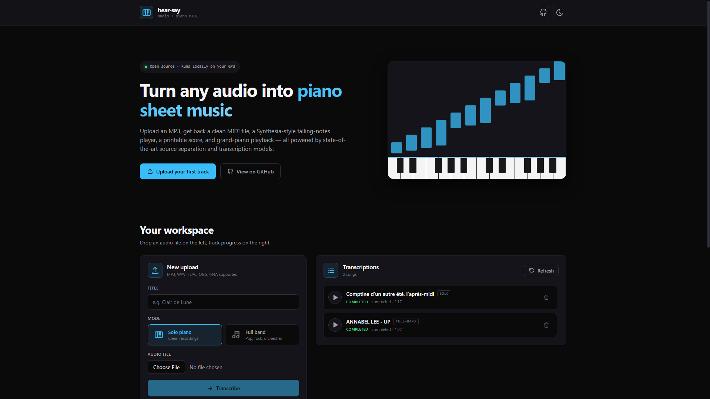
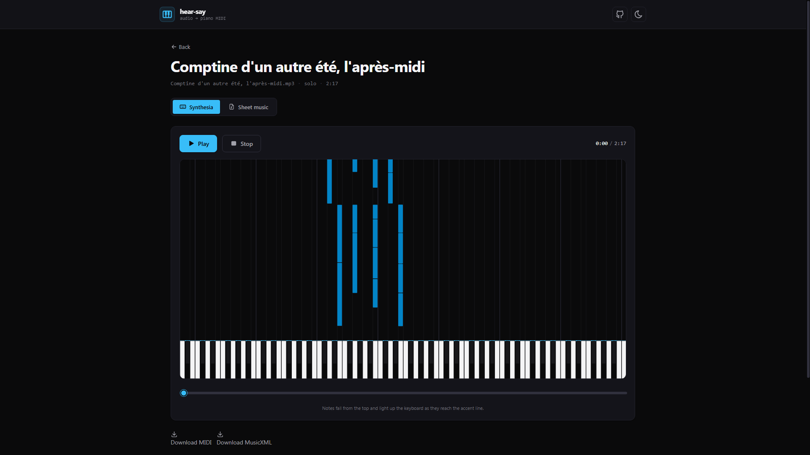
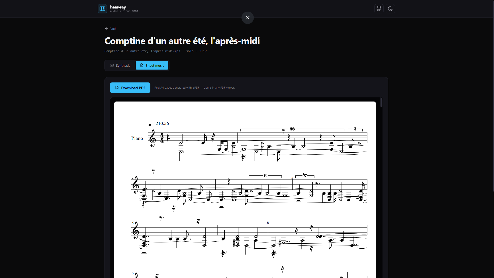
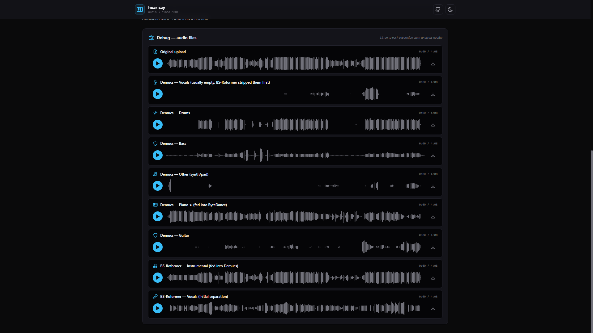

# hear-say

Turn any audio into piano sheet music. Upload an MP3, get back a MIDI file, a
Synthesia-style falling-notes player, real A4 sheet music, and grand-piano
playback — all running locally on your GPU.

### Home page — landing, upload form, transcription history and feature cards



## Song detail page with the Synthesia-style falling-notes player



## Song detail page with the generated MIDI piano roll and MusicXML sheet music



## Debug panel showing the separation stems from BS-Roformer and Demucs



## Features

- **Solo piano transcription** — ByteDance Piano Transcription (F1 ~0.97),
  near-perfect on MAESTRO-style recordings.
- **Full-band transcription** — BS-Roformer + Demucs cascade isolates the
  piano stem from a full mix, then ByteDance transcribes it.
- **Synthesia-style player** — 88-key keyboard with falling notes, theme-aware
  canvas, click-to-seek slider, real grand-piano playback via Tone.js Sampler.
- **Real A4 sheet music PDFs** — OpenSheetMusicDisplay generates the score,
  jsPDF + svg2pdf.js export true A4 pages client-side (no browser-print
  trickery, no server dependency).
- **Waveform debug players** — every separation stem (vocals, drums, bass,
  other, piano, guitar, plus BS-Roformer's own outputs) is a wavesurfer.js
  player you can scrub and download for quality diagnostics.
- **Light and dark themes** — CSS variables everywhere, palette follows your
  system preference by default.
- **Local first** — no cloud, no telemetry, everything on your own machine.

## Accuracy

Solo piano recordings and piano-driven ballads are solved. Dense orchestral,
atmospheric, or spoken-word tracks still trip up source separation — that's
a limit of current models, not a bug we can fix.

## How it works

```
  audio file                              piano MIDI + MusicXML + PDF
      │                                               ▲
      ▼                                               │
  ┌────────────────────────────────────────────────────────┐
  │  SOLO MODE                                             │
  │     ByteDance Piano Transcription (MAESTRO SOTA)       │
  │                                                        │
  │  FULL-BAND MODE (cascade)                              │
  │     1. BS-Roformer        → vocals removed             │
  │     2. Demucs htdemucs_6s → piano stem isolated        │
  │     3. ByteDance          → piano MIDI                 │
  └────────────────────────────────────────────────────────┘
```

### Solo mode

Your MP3 goes straight into **ByteDance Piano Transcription**, a piano-specific
model trained on MAESTRO. Output is clean MIDI with onsets, pitches, and pedal
events.

### Full-band mode

Three separators run in sequence on dense mixes:

1. **BS-Roformer** (2024 SOTA vocal separation, via `audio-separator`) strips
   the vocals.
2. **Demucs htdemucs_6s** runs on the vocal-free instrumental — a 6-stem model
   producing vocals/drums/bass/other/piano/guitar. With the vocals already
   gone, the piano stem comes out much cleaner than a single-pass run.
3. **ByteDance Piano Transcription** runs on the isolated piano stem.

Demucs is configured with `shifts=5, overlap=0.5` for maximum separation
quality. Slower, but well within the pipeline budget on an RTX 4070.

### Post-processing

A minimal denoise pass drops obvious artifacts (velocity < 1, duration < 10 ms,
pitch outside A0–C8). Everything else is left alone — ByteDance's output is
already clean and heavier filtering has been shown to remove real notes.

## Requirements

- **NVIDIA GPU** with CUDA support (RTX 2060 or newer). ~4–6 GB VRAM is enough
  in practice — peak observed around 5 GB running five concurrent jobs.
- **Docker Desktop** (Windows/macOS) or **Docker Engine + NVIDIA Container
  Toolkit** (Linux).
- **~10 GB disk** for the image and bundled model weights.
- **Internet** on first build only (base images, wheels, model weights).

## Quick start

```bash
git clone https://github.com/batuhanalperen/hear-say.git
cd hear-say
docker compose up -d
```

First build takes ~10–15 minutes — the CUDA base image, PyTorch wheels,
audio-separator, Demucs, and ByteDance all land in a single multi-stage image,
and model weights (~370 MB) are pre-fetched at build time so the first
request has no download delay.

Open http://127.0.0.1:7777 once the container is healthy.

### Updating

```bash
git pull
docker compose up -d --build
```

### Stopping

```bash
docker compose down
```

### Resetting data

Uploads, generated MIDI, and the SQLite history all live under `./data/`.
Delete it for a clean slate:

```bash
docker compose down
rm -rf ./data
docker compose up -d
```

## Architecture

```
┌────────────────────────────────────────────┐
│                                            │
│   Browser ── Nuxt 3 SPA                    │
│     (UnoCSS, Tone.js, @tonejs/midi, OSMD,  │
│      wavesurfer.js, jsPDF + svg2pdf.js)    │
│      │                                     │
│      ▼                                     │
│   FastAPI (port 7777)                      │
│      │                                     │
│      ├── POST /api/songs/upload            │
│      ├── GET  /api/songs, /:id, /stems/... │
│      └── Nuxt SPA static files + fallback  │
│      │                                     │
│      ▼                                     │
│   Background job worker                    │
│      │                                     │
│      ├── audio-separator (BS-Roformer)     │
│      ├── Demucs htdemucs_6s                │
│      ├── ByteDance Piano Transcription     │
│      └── music21 → MusicXML                │
│      │                                     │
│      ▼                                     │
│   SQLite + ./data/ volume                  │
│                                            │
└────────────────────────────────────────────┘
```

### Stack

- **Backend:** Python 3.10, FastAPI, SQLModel, PyTorch (CUDA 12.1)
- **ML models:** ByteDance Piano Transcription,
  `model_bs_roformer_ep_317_sdr_12.9755`, Demucs `htdemucs_6s`
- **Frontend:** Nuxt 3 (SPA mode), Vue 3, UnoCSS, VueUse, Tone.js,
  `@tonejs/midi`, OpenSheetMusicDisplay, wavesurfer.js, jsPDF, svg2pdf.js
- **Runtime:** Single Docker image (multi-stage — Node frontend build, then
  CUDA Python runtime). Model weights (~370 MB) are baked in at build time.

## Configuration

All settings live in environment variables, set in `docker-compose.yml`:

| Variable            | Default | Notes                                     |
| ------------------- | ------- | ----------------------------------------- |
| `HEAR_SAY_DEVICE`   | `cuda`  | Set to `cpu` to run without a GPU (slow). |
| `HEAR_SAY_DATA_DIR` | `/data` | Mounted from `./data/` on the host.       |

## Limitations

- Needs a CUDA GPU. CPU mode technically works but is impractical.
- Full-band quality depends on how prominent the piano is in the mix. Spoken
  word or atmospheric-pad tracks produce noise — no model can infer notes
  that aren't there.
- First build downloads ~2 GB of PyTorch wheels and ~400 MB of model weights.
- Docker Desktop on Windows needs GPU support enabled; Linux needs the NVIDIA
  Container Toolkit installed on the host.

## Credits

- [ByteDance Piano Transcription](https://github.com/bytedance/piano_transcription) — the piano transcription model
- [BS-Roformer](https://github.com/lucidrains/BS-RoFormer) — vocal source separation
- [Demucs](https://github.com/facebookresearch/demucs) — multi-stem source separation
- [audio-separator](https://github.com/nomadkaraoke/python-audio-separator) — Python wrapper for UVR community models
- [Salamander Grand Piano](https://archive.org/details/SalamanderGrandPianoV3) — playback samples, served via Tone.js CDN
- [OpenSheetMusicDisplay](https://github.com/opensheetmusicdisplay/opensheetmusicdisplay) — sheet music rendering
- [Tone.js](https://tonejs.github.io/) + [@tonejs/midi](https://github.com/Tonejs/Midi) — web audio playback and MIDI parsing
- [wavesurfer.js](https://wavesurfer.xyz/) — waveform visualisation for the debug audio panel
- [jsPDF](https://github.com/parallax/jsPDF) + [svg2pdf.js](https://github.com/yWorks/svg2pdf.js) — client-side PDF export for sheet music
- [music21](https://web.mit.edu/music21/) — MusicXML export

## License

MIT — see [LICENSE](LICENSE).
